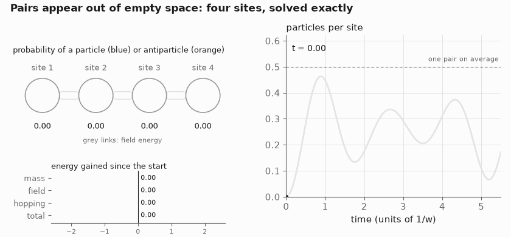
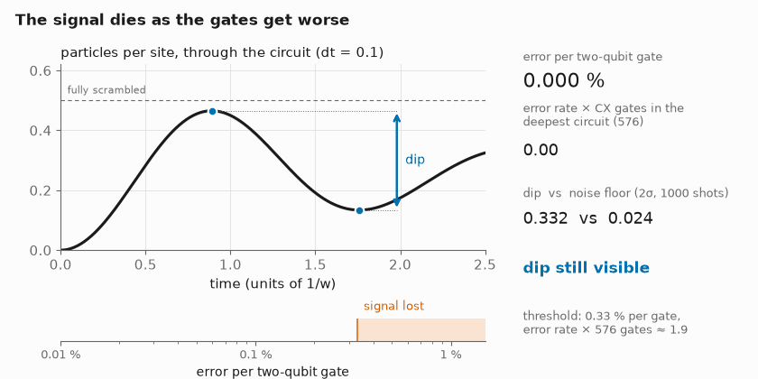

# A quantified error budget for quantum simulation of the lattice Schwinger model

Electrons, positrons and their electric field on four qubits, with every
error measured against the exact answer.

PHY 420 senior thesis, Gettysburg College, Fall 2026. Abror Niyazmetov,
advised by Dr. Kurt Andresen.

[Read the thesis (PDF)](thesis/main.pdf) · [Take the tour](docs/tour/README.md) · [Run it yourself](#run-it-yourself) · [How every number is checked](#how-every-number-is-checked)

<p align="center">
  
</p>

## The project in one paragraph

Start with empty space on a line of four sites, switch on the physics of
electrons and their electric field, and particle-antiparticle pairs appear,
recombine and appear again (above, computed exactly). A quantum computer can
follow this in real time, which ordinary computers find hard, but every answer
it gives carries error from three sources: chopping time into steps,
measuring only a finite number of times, and imperfect gates. In 2016 a team
in Innsbruck ran this simulation on four trapped-ion qubits
([Martinez et al., Nature 534, 516](https://doi.org/10.1038/nature18318)), and
their data drifted away from the exact curve. This project rebuilds that
experiment on a simulated quantum computer where the exact answer is known at
every stage, switches the errors on one at a time, and measures how much each
one moves the result.

## What came out

All at four sites, with the parameters of the 2016 experiment.

### 1. Past a certain step size, smaller time steps buy nothing you can see

At 1000 shots, the error from chopping time falls below the shot noise at a
step of 0.18 (about 17 steps to time 3). Finer steps only add gates.
[Chapter 4 →](docs/tour/04-time-steps-and-shots.md)

### 2. The signal dies when error rate × two-qubit gates ≈ 2

The pair-production signal is lost in the noise when the two-qubit gate error
times the number of CX gates in the deepest circuit reaches 1.92, 1.98 and
2.03 for three different step sizes, which is about one error's worth per
qubit. [Chapter 5 →](docs/tour/05-gate-errors.md)

<p align="center">
  
</p>

### 3. Worse hardware wants coarser steps

With gate error there is a best
step size, and it grows from 0.35 to 0.44 to 0.59 as the two-qubit error goes
from 0.03 % to 0.1 % to 0.3 %. Refining past it makes the answer worse.
[Chapter 5 →](docs/tour/05-gate-errors.md#putting-every-error-together-the-best-step-size)

### 4. A warning light that works, with a blind spot

Without knowing the
right answer, the spread of the measured total charge predicts the failure
point 10 to 17 % too optimistically for depolarising noise and 27 to 42 % for
dephasing on the gates. It reads exactly zero for dephasing between time
steps, which is the noise model fitted to the 2016 data.
[Chapter 6 →](docs/tour/06-warning-light.md)

Also: the ground state, found with a sample-based Krylov method (SKQD) from
the same circuits, reaches a relative energy error of $10^{-3}$ from 12 shots
per circuit, or 15 with gate error. [Chapter 7 →](docs/tour/07-ground-state-from-bitstrings.md)

## Read it at the depth you want

| You have | Read |
|---|---|
| 2 minutes | This page, down to here |
| 45 minutes | [The tour](docs/tour/README.md): nine short chapters from "why simulate empty space?" to "where this stops", built up from basic quantum mechanics, with the math in boxes you can open or skip |
| An evening | [The thesis](thesis/main.pdf): about 8,000 words, 62 references |
| A weekend | [`docs/derivation.md`](docs/derivation.md), the Hamiltonian derived from the continuum Lagrangian, and [`docs/error-budget.md`](docs/error-budget.md), the noise and error analysis in full |
| Doubts about a number | Run the script that prints it (below), or [break the code on purpose](docs/tour/08-how-we-know-it-is-right.md#break-it-yourself) and watch the tests catch it |

Chapters of the tour:
[1 Why simulate empty space?](docs/tour/01-why-simulate-empty-space.md) ·
[2 Four sites, four qubits](docs/tour/02-four-sites-four-qubits.md) ·
[3 Why pairs appear](docs/tour/03-why-pairs-appear.md) ·
[4 Time steps and shots](docs/tour/04-time-steps-and-shots.md) ·
[5 Imperfect gates](docs/tour/05-gate-errors.md) ·
[6 The warning light](docs/tour/06-warning-light.md) ·
[7 Ground state from bitstrings](docs/tour/07-ground-state-from-bitstrings.md) ·
[8 How we know it is right](docs/tour/08-how-we-know-it-is-right.md) ·
[9 Where this stops](docs/tour/09-where-this-stops.md) ·
[Glossary](docs/tour/glossary.md)

## The model in one equation

```math
\hat H \;=\; \underbrace{\frac{m}{2}\sum_{n=1}^{4}(-1)^n \hat Z_n}_{\text{mass}}
\;+\; \underbrace{w\sum_{n=1}^{3}\left(\hat\sigma^+_n\hat\sigma^-_{n+1} + \mathrm{h.c.}\right)}_{\text{hopping}}
\;+\; \underbrace{J\sum_{n=1}^{3}\hat L_n^{\,2}}_{\text{electric field}},
\qquad
\hat L_n = \frac12\sum_{k\le n}\bigl[\hat Z_k + (-1)^k\bigr]
```

Quantum electrodynamics in one space dimension (the Schwinger model) on four
staggered sites with open ends. Solving Gauss's law removes the electric field
as a separate variable, so four sites need exactly four qubits, and the
Jordan-Wigner transformation turns the fermions into 14 Pauli strings. This
is the spin Hamiltonian of Martinez et al. (Methods, Eq. 3 in
[arXiv:1605.04570v1](https://arxiv.org/abs/1605.04570v1)). Parameters
throughout: $m = 0.5\,w$, $J = w$, time in units of $1/w$.
[Chapter 2](docs/tour/02-four-sites-four-qubits.md) builds it step by step.

## Run it yourself

Python 3.11 or newer. [`SETUP.md`](SETUP.md) has a slower, step-by-step
version.

```bash
python3 -m venv .venv && source .venv/bin/activate
pip install -r requirements.txt         # exact versions used: requirements-lock.txt
python -m pytest tests/ -q              # 496 tests, each against an independently known answer
python scripts/03_schwinger_spectrum.py # the Hamiltonian and its checks
```

Each script prints the numbers behind its results, and all but script 09
also redraw their figures (PNG and PDF, in [`figures/`](figures)):

| Script | Shows | Tour |
|---|---|---|
| `01_tfim_phase_transition.py`, `02_jw_verification.py` | the warm-up: Jordan-Wigner checked on the Ising chain | [8](docs/tour/08-how-we-know-it-is-right.md) |
| `03_schwinger_spectrum.py` | the 14 Pauli strings, all 16 energy levels, the analytic limits | [2](docs/tour/02-four-sites-four-qubits.md) |
| `04_pair_production_preview.py` | pairs out of the vacuum, computed exactly | [3](docs/tour/03-why-pairs-appear.md) |
| `05_qiskit_trotter.py` | Trotter scaling, shots, the crossover | [4](docs/tour/04-time-steps-and-shots.md) |
| `06_noise_threshold.py` | gate error, the failure threshold, the warning light (about five minutes) | [5](docs/tour/05-gate-errors.md), [6](docs/tour/06-warning-light.md) |
| `07_skqd_ground_state.py` | the SKQD ground state and its exact shot cost | [7](docs/tour/07-ground-state-from-bitstrings.md) |
| `08_error_budget.py` | all errors together, the best step size | [5](docs/tour/05-gate-errors.md) |
| `09_verification_table.py` | every row of the thesis verification table | [8](docs/tour/08-how-we-know-it-is-right.md) |
| `10_talk_figures.py` | the figures for the capstone talk | |
| `11_martinez_replication.py` | Fig. 2(a) of the 2016 paper, recomputed | [8](docs/tour/08-how-we-know-it-is-right.md) |
| `12_larger_lattices.py` | the same model solved exactly on up to 12 sites | [3](docs/tour/03-why-pairs-appear.md) |
| `13_lattice_states.py` | what each bitstring means: charges, fields, energies | [2](docs/tour/02-four-sites-four-qubits.md) |
| `14_readme_animations.py` | the two animations on this page, checked against the thesis numbers | |

`bash scripts/verify_all.sh` runs all of it in about ten minutes and rewrites
[`VERIFICATION.txt`](VERIFICATION.txt), the log every number in the thesis
traces back to. The notebook
[`notebooks/schwinger_walkthrough.ipynb`](notebooks/schwinger_walkthrough.ipynb)
walks through the Hamiltonian and circuits as code, with its output saved so
it reads on GitHub without running anything.

## How every number is checked

The working rule: every stage has an answer known in advance by an
independent route, and nothing is trusted because it looks right. Checks
report the size of the disagreement, not a pass or fail flag.

| Check | Residual |
|---|---|
| Hamiltonian built three independent ways | 0 to $9\times10^{-16}$ |
| Strong-coupling and free-fermion limits | 0 and $9\times10^{-16}$ |
| Circuit against exact evolution, 4000 steps | $7\times10^{-8}$ |
| Trotter error slopes, predicted 1 and 2 | 1.036 and 2.003 |
| Quoted shot noise against the scatter of 400 simulated runs | ratio 0.97 to 1.01 |
| Published curves of Martinez et al. Fig. 2(a), recomputed | within 0.001 |

[Chapter 8](docs/tour/08-how-we-know-it-is-right.md) has the full ledger, the
mistakes the checks caught, and three one-line ways to break the code that the
tests catch (6, 102 and 22 failures). A fresh run of the whole pipeline on
17 November 2026 reproduced the 2 November log line for line.

## What is where

```
src/schwinger/          the package
  paulis.py             Pauli strings, conventions, the Qiskit qubit-order adapter
  jordan_wigner.py      fermions to qubits, and the algebra checks
  ising.py              the transverse-field Ising warm-up and its exact spectrum
  schwinger.py          the Hamiltonian (three constructions), Gauss's law, CP
  observables.py        particle density, condensate, fields, exact evolution
  analytics.py          the analytic limits everything is checked against
  circuits.py           Trotter circuits, compilation, shots
  noise.py              gate and readout error, exact noisy probabilities
  diagnostics.py        observables and symmetry checks from one measurement
  budget.py             the error budget, the threshold and its prediction
  skqd.py               the SKQD ground state with its exact shot cost
  finite_size.py        the same model on up to 12 sites
  replication.py        the 2016 experiment's curves
tests/                  496 tests, each against an independently known answer
scripts/                one per figure, printing the numbers behind it
figures/                every figure, PNG and PDF, regenerated by the scripts
docs/tour/              the nine-chapter tour and glossary
docs/derivation.md      the Hamiltonian from the continuum Lagrangian
docs/error-budget.md    noise, diagnostics, the budget and SKQD in full
docs/LEARNING.md        reading guide, topic by topic
thesis/                 the thesis in LaTeX; main.pdf is the current build
CONVENTIONS.md          site order, signs, Qiskit qubit numbering
VERIFICATION.txt        the log of one full run of everything
```

The thesis includes the figure PDFs straight from `figures/`, so rerunning a
script updates the thesis on the next compile (`cd thesis && make`).

## Statement on AI assistance

I used AI tools to write the scaffolding of the code, to debug it
(particularly the sign conventions in the Jordan-Wigner strings), to find my
way through the literature and to draft text. The derivations, the design of
the numerical experiments and the analysis are mine. Every claim an AI tool
made about a paper was checked against that paper before it entered this
repository.

The checks built into the project caught errors in what the tools drafted, all
corrected in this version. Two were in the code: a wrong guess about Qiskit's
qubit order and an ill-conditioned step in the Ising-chain check. The third was
a physics claim, that dephasing on the compiled gates is invisible to the
charge diagnostic. Simulation showed this holds only for dephasing on the
logical state (thesis Section 3.6).

A review of the draft then found statements that the numbers contradicted. Two
test tolerances were quoted as measured residuals. The symmetry argument for
CP (thesis Eq. 8) claimed more than it proved, and the two components of ψ were
described wrongly. The Hellmann-Feynman check was presented as stronger than it
is, and the account of where the energy of the produced pairs comes from had it
backwards.

Checking every literature claim against its paper, before the Discussion was
written, found four errors in the Introduction and Methods. Shaw et al.'s bound
adds the Trotter and gate biases linearly, not in quadrature. Rosanowski et al.
report energies on up to 20 qubits, not 30, and quote their gate fidelity
rather than measure it. Halimeh and Hauke's penalty result had been quoted
without its restriction to coherent errors. Reproducing the curves of Martinez
et al. found the last one: Methods had written the first-order step in reverse
order.

---

MIT License. See [`LICENSE`](LICENSE).
