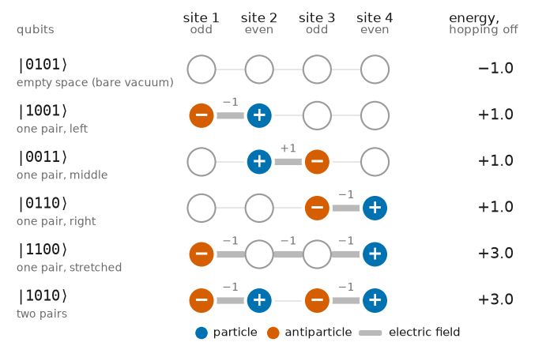

[← Previous](01-why-simulate-empty-space.md) · [Tour](README.md) · *2 of 9* · [Next: why pairs appear →](03-why-pairs-appear.md)

# 2. From a line of space to four qubits

The continuous line has infinitely many points. A computer needs a finite
list. This chapter turns one into the other in four moves, and ends with the
whole model written as 14 terms on four qubits.

## Move 1: keep only a few points

Replace the line by evenly spaced points, called *sites*, a distance $a$
apart. This is the same idea as the grid in a finite-difference calculation:
the sites are an approximation we choose, not objects in nature. Here there
are four of them, with open ends.

Each site either holds a particle or holds nothing. There is no room for two,
because these are fermions (the Pauli exclusion principle), and in one
dimension an electron has no spin to tell two of them apart. A yes-or-no
question per site is exactly one qubit per site.

## Move 2: put particles and antiparticles on alternating sites

Putting the electron's equation on a grid naively produces a fake extra
particle, a lattice artefact called a fermion doubler. The standard fix,
staggered fermions ([Kogut and Susskind 1975](https://doi.org/10.1103/PhysRevD.11.395)),
splits the electron's two components across alternating sites. The result is
easy to state:

- *even sites* (2 and 4) can hold a *particle*, charge $+1$;
- *odd sites* (1 and 3) can hold an *antiparticle*, charge $-1$;
- *empty space* is every site holding nothing.

<details>
<summary><b>Why the computer stores empty space as |0101⟩</b> (the Dirac sea)</summary>

The qubits do not record charge directly. They record whether a fermion
*occupies* each site, with $|0\rangle$ meaning occupied and $|1\rangle$ empty.
On the staggered lattice a fermion on an odd site lowers the energy, so in
empty space the odd sites are full and the even sites empty: $|0101\rangle$,
site 1 on the left. This is Dirac's picture of the vacuum as a filled "sea".

In that bookkeeping a particle is a fermion on an even site (above the sea),
and an antiparticle is a missing fermion on an odd site (a hole in the sea).
The charge on site $n$ measures the departure from the vacuum:

```math
\hat\rho_n = \hat c^\dagger_n \hat c_n - \frac{1 - (-1)^n}{2},
```

which is $0$ on every site of $|0101\rangle$, $+1$ on a filled even site and
$-1$ on an emptied odd site. The particle picture above and the occupation
picture here describe the same states; the figure below shows both.

</details>

## Move 3: let the charges fix the field

The electric field lives on the *links* between sites. In one dimension
Gauss's law leaves it no freedom at all: the field on a link equals the total
charge to its left (open boundary, no background field),

```math
\hat L_n = \sum_{k \le n} \hat\rho_k .
```

So the field needs no qubits of its own. Four sites need four qubits, full
stop. The price is that the field on link $n$ depends on every site to its
left, so the field energy couples sites that are not neighbours.

This also explains confinement on the lattice. A pair whose charges sit $r$
links apart has field $\pm 1$ on each of those $r$ links, and each costs the
same energy $J$. The cost grows in proportion to the separation.

Here is every arrangement with zero total charge, the only ones the
simulation ever visits from empty space. Charges, fields and energies are all
computed from the package's own operators, not typed in:

<p align="center">
   at energy -1; three neighbouring pairs |1001>, |0011>, |0110> at energy +1 with field on one link; the stretched pair |1100> with field on all three links and two pairs |1010>, both at energy +3.">
</p>

Read each row from left to right: the bitstring is what the four qubits
store, and the discs are what it means physically. Each charge costs
$m = 0.5$ and each unit of field on a link costs $J = 1$
(energies in units of $w$). One neighbouring pair costs $2 \times 0.5 + 1 = 2$
above empty space. Stretch the same pair across the whole chain, $|1100\rangle$,
and the field costs three links instead of one.

## Move 4: write the energy as qubit operators

The Hamiltonian has three terms, and each has a plain meaning.

```math
\hat H \;=\; \underbrace{\frac{m}{2}\sum_{n=1}^{4}(-1)^n \hat Z_n}_{\text{mass}}
\;+\; \underbrace{w\sum_{n=1}^{3}\left(\hat\sigma^+_n\hat\sigma^-_{n+1} + \mathrm{h.c.}\right)}_{\text{hopping}}
\;+\; \underbrace{J\sum_{n=1}^{3}\hat L_n^{\,2}}_{\text{field}}
```

*Mass.* $\hat Z_n$ is $+1$ on an occupied site and $-1$ on an empty one. The
sign $(-1)^n$ makes every particle and every antiparticle cost $m$.

*Hopping.* $\hat\sigma^+_n\hat\sigma^-_{n+1}$ moves a fermion from site $n+1$
to site $n$, and "h.c." (Hermitian conjugate) adds the reverse move. This is
the kinetic energy: on a grid a derivative becomes a difference between
neighbours, so the energy connects neighbouring sites, the way an electron
tunnels between neighbouring atoms in a crystal. Because neighbouring sites
are always one odd and one even, **every hop either creates a particle and an
antiparticle side by side, or removes such a pair.** Starting from empty
space, the three possible hops make the three neighbouring pairs in the
figure. Hopping is the only term that changes the arrangement; the other two
just assign it an energy.

*Field.* $J$ per link per unit of field, squared. With $\hat L_n$ written in
qubit operators, $\hat L_n = \tfrac12\sum_{k\le n}[\hat Z_k + (-1)^k]$.

<details>
<summary><b>How fermions become qubits</b> (Jordan-Wigner, and the minus sign that is not a bug)</summary>

Fermion operators on different sites anticommute,
$\hat c_n \hat c_k = -\hat c_k \hat c_n$, while operators on different qubits
commute. The Jordan-Wigner transformation
([Jordan and Wigner 1928](https://doi.org/10.1007/BF01331938)) supplies the
missing signs with a string of $\hat Z$ operators on every site to the left:

```math
\hat c_n = \Bigl(\prod_{k<n}\hat Z_k\Bigr)\hat\sigma^-_n ,
\qquad
\hat c^\dagger_n \hat c_n = \tfrac12\bigl(1 + \hat Z_n\bigr).
```

Between neighbours the strings cancel except for one $\hat Z$, which gives
$\hat c^\dagger_n \hat c_{n+1} = -\hat\sigma^+_n\hat\sigma^-_{n+1}$. That minus
sign is real, and it is removable: relabelling $\hat c_n \to (-1)^n \hat c_n$
flips it without changing a single energy level. The code settles this
numerically instead of by argument (`hopping_sign_demo` in
[`jordan_wigner.py`](../../src/schwinger/jordan_wigner.py), printed by
`scripts/02`). [`CONVENTIONS.md`](../../CONVENTIONS.md) section 4 has the
details, because this sign is the classic place to "fix" a correct answer
into a wrong one.

</details>

Expanded, the Hamiltonian is a sum of *Pauli strings*: one Pauli matrix
($X$, $Y$, $Z$) or the identity $I$ per qubit, written left to right from
site 1. The hopping becomes $\tfrac12 w(\hat X_n\hat X_{n+1} + \hat Y_n\hat Y_{n+1})$.
The whole four-site model is 14 such strings:

<details>
<summary><b>The 14 Pauli strings</b> (printed by <code>scripts/03_schwinger_spectrum.py</code>)</summary>

| String | Coefficient | From | String | Coefficient | From |
|---|---|---|---|---|---|
| `IIII` | $+2J$ | field | `IIXX`, `IIYY` | $+\tfrac12 w$ | hopping |
| `IIIZ` | $+\tfrac12 m$ | mass | `IXXI`, `IYYI` | $+\tfrac12 w$ | hopping |
| `IIZI` | $-\tfrac12 m - \tfrac12 J$ | mass, field | `XXII`, `YYII` | $+\tfrac12 w$ | hopping |
| `IZII` | $+\tfrac12 m - \tfrac12 J$ | mass, field | `ZZII` | $+J$ | field |
| `ZIII` | $-\tfrac12 m - J$ | mass, field | `ZIZI`, `IZZI` | $+\tfrac12 J$ | field |

`ZIZI` couples sites 1 and 3, which are not neighbours: the price of removing
the field, visible in one line. Site 4 never enters a field term, because the
three links' fields only add up charges on sites 1 to 3. And `ZZII` has twice
the coefficient of `ZIZI` because sites 1 and 2 appear together in two of the
three link fields ($\hat L_2$ and $\hat L_3$), while sites 1 and 3 share only
one ($\hat L_3$).

</details>

## The numbers used everywhere

All results use $N = 4$, $J = w$ and $m = 0.5\,w$, the parameters of the main
data set of Martinez et al., with time measured in units of $1/w$. This is a
coarse lattice, far from the continuum limit, and nothing here claims to
describe the continuum.

> [!TIP]
> *Check it yourself.*
> `python scripts/03_schwinger_spectrum.py` prints the 14 strings and checks
> the matrix three independent ways (largest disagreement $9\times10^{-16}$).
> `python scripts/13_lattice_states.py` prints the charges, fields and
> energies in the figure above and checks Gauss's law on each row.

*In the code:* [`schwinger.py`](../../src/schwinger/schwinger.py) (the
Hamiltonian, built three ways), [`paulis.py`](../../src/schwinger/paulis.py),
[`jordan_wigner.py`](../../src/schwinger/jordan_wigner.py); tested in
[`tests/test_schwinger.py`](../../tests/test_schwinger.py) and
[`tests/test_jordan_wigner.py`](../../tests/test_jordan_wigner.py).
*In the thesis:* Section 2, Theory.
*Deeper:* [`docs/derivation.md`](../derivation.md) derives all of this from
the continuum Lagrangian, sections 2 to 5.

[← Previous](01-why-simulate-empty-space.md) · [Tour](README.md) · [Next: why pairs appear →](03-why-pairs-appear.md)
