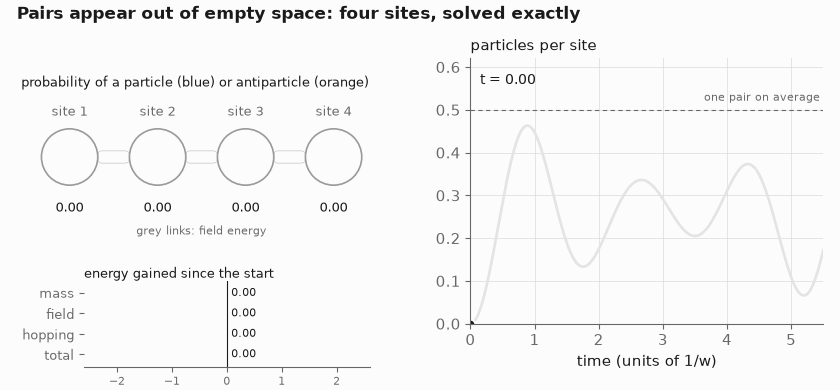
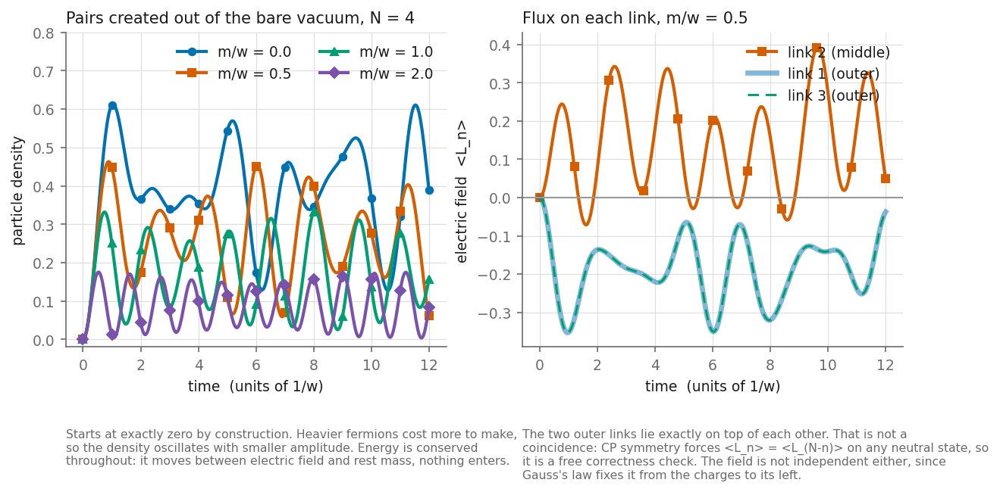
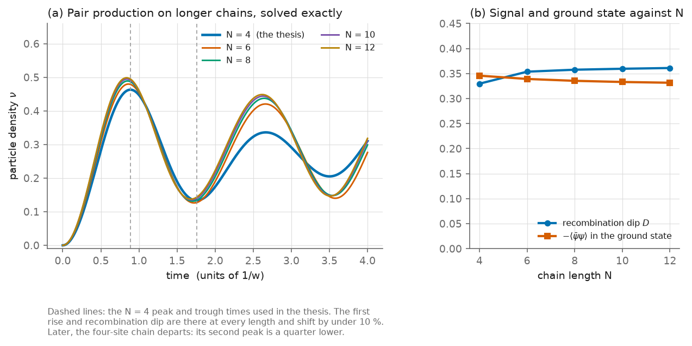

[← Previous](02-four-sites-four-qubits.md) · [Tour](README.md) · *3 of 9* · [Next: time steps and shots →](04-time-steps-and-shots.md)

# 3. Why pairs appear

The simulation starts in empty space, $|0101\rangle$, and nothing is added.
Pairs appear anyway. This chapter explains why, follows the energy, and picks
out the one feature of the result that the rest of the project tries to
protect.

## A state that cannot sit still

In quantum mechanics only states of definite energy (eigenstates of the
Hamiltonian) stand still. Anything else changes with time, because the
Schrödinger equation gives each energy component a phase that turns at its
own rate:

```math
|\psi(t)\rangle = e^{-i\hat H t}\,|\psi(0)\rangle
= \sum_j e^{-iE_j t}\,\langle E_j|\psi(0)\rangle\,|E_j\rangle .
```

As the phases drift apart, the probabilities of the different arrangements
change.

The smallest example is one particle in two boxes with a thin wall between
them. Start it in the left box. Once tunnelling through the wall is allowed,
"left" is not a state of definite energy: the definite-energy states are the
even and odd mixtures of left and right, at slightly different energies. Their
phases drift apart, and the chance of finding the particle on the right rises
and falls.

The four-site chain does the same thing with six arrangements instead of two
boxes, and hopping in place of the thin wall. Empty space is the lowest-energy
arrangement as long as hopping is off. Switch hopping on and $|0101\rangle$
stops being a state of definite energy. It is now a mixture of five energy
levels, 71 % of it the true ground state. Changing the Hamiltonian suddenly
under a state like this is called a *quench*.

## What it looks like

<p align="center">
  
</p>

The curve is the *particle density* $\nu(t)$: the average number of
particles plus antiparticles per site. At four sites, $\nu = 0.5$ means one
pair on average. It rises to 0.463 at $t = 0.89$ (0.93 pairs on average),
falls to 0.133 at $t = 1.76$ as pairs recombine, and swings up again. The
swings never repeat exactly, because five phases turning at unrelated rates
never all line up again.

<details>
<summary><b>The density as a formula</b></summary>

```math
\nu(t) = \frac{1}{2N}\sum_{n=1}^{N}\Bigl[\,1 + (-1)^n \langle \hat Z_n(t)\rangle\Bigr].
```

Each term is 0 on a site that matches empty space and 2 on a site that holds
a particle or antiparticle. Every quantity in it is a $\hat Z$, so one
measurement of all four qubits in the computational basis gives it. That will
matter in [chapter 4](04-time-steps-and-shots.md).

</details>

## Where the energy comes from

Nothing pumps energy in. The total stays at exactly $-1.00$ (in units of $w$)
for the whole run; the largest drift the code finds is $5\times10^{-15}$,
which is rounding error.

What changes is how the total is split. Empty space has the mass and field
terms at their lowest possible values, and zero hopping energy, because a
single arrangement has none. Making pairs raises the mass energy (each
particle costs $m$) and the field energy (each pair has field between its
charges). The hopping energy pays for both by going negative. At the first
peak, $t = 0.89$, the books read:

| | change since $t = 0$ |
|---|---|
| mass | $+0.93$ |
| field | $+0.97$ |
| hopping | $-1.90$ |
| *total* | *0.00* |

Hopping energy goes negative because a quantum particle spread over
neighbouring positions has lower kinetic energy than one held in place. The
state spreads over arrangements, and that spreading is what pays for the
pairs.

<details>
<summary><b>Lighter particles, more pairs</b></summary>

The further the starting state is from the true ground state, the more pairs
appear. With $J = w$, from `scripts/04`:

| $m/w$ | energy of empty space | true ground energy | gap | largest $\nu$ |
|---|---|---|---|---|
| 0.0 | 0.000 | −1.477 | 1.477 | 0.612 |
| 0.5 | −1.000 | −2.075 | 1.075 | 0.463 |
| 1.0 | −2.000 | −2.828 | 0.828 | 0.335 |
| 2.0 | −4.000 | −4.553 | 0.553 | 0.175 |



</details>

## The signal

The feature this project tracks is the first rise and fall: the *dip*

```math
D = \nu(t_{\mathrm{p}}) - \nu(t_{\mathrm{t}}),\qquad t_{\mathrm{p}} = 0.89,\; t_{\mathrm{t}} = 1.76,
```

the drop from the first peak to the first trough, $D = 0.33$ in the exact
evolution. A dip can only come from pairs forming and then recombining, which
is the physics the simulation exists to show. Noise flattens it, as
[chapter 5](05-gate-errors.md) shows.

## Are four sites enough?

Four sites is small, so the same Hamiltonian was solved exactly on chains of
up to 12 sites (924 arrangements with zero charge):

<p align="center">
  
</p>

Going from 4 to 12 sites makes the dip 9 % deeper, moves the peak and trough
4 to 6 % earlier, and changes the ground-state condensate by 4 %. After the
first trough the short chain drifts off: its second peak is a quarter lower
(0.336 against 0.449). So the project uses only the first swing, where four
sites already get the physics right. The spacing between sites is the same in
every chain, so this says nothing about the continuum limit.

## Two things that never change

Two quantities stay fixed through the whole evolution, and they come back in
[chapter 6](06-warning-light.md) as the warning light. The *total charge*
stays at zero (its variance never exceeds $10^{-33}$), because the Hamiltonian
conserves it. And the *two outer links carry identical field* at every
moment (difference below $10^{-15}$), because of a mirror symmetry that swaps
particles with antiparticles. Noise can break both.

> [!TIP]
> *Check it yourself.*
> `python scripts/04_pair_production_preview.py` prints the conservation
> checks and the table above. `python scripts/12_larger_lattices.py` solves
> the chains up to 12 sites. `python scripts/14_readme_animations.py` rebuilds
> the animation and checks that it shows the numbers quoted here.

*In the code:* [`observables.py`](../../src/schwinger/observables.py) (exact
evolution and every observable), [`finite_size.py`](../../src/schwinger/finite_size.py)
(the longer chains); tested in [`tests/test_finite_size.py`](../../tests/test_finite_size.py).
*In the thesis:* Section 2.7 (Observables) and Section 4.1 (Results).

[← Previous](02-four-sites-four-qubits.md) · [Tour](README.md) · [Next: time steps and shots →](04-time-steps-and-shots.md)
