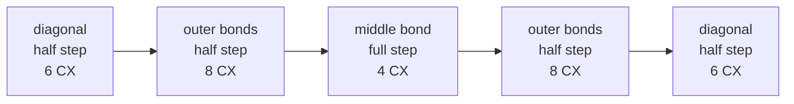
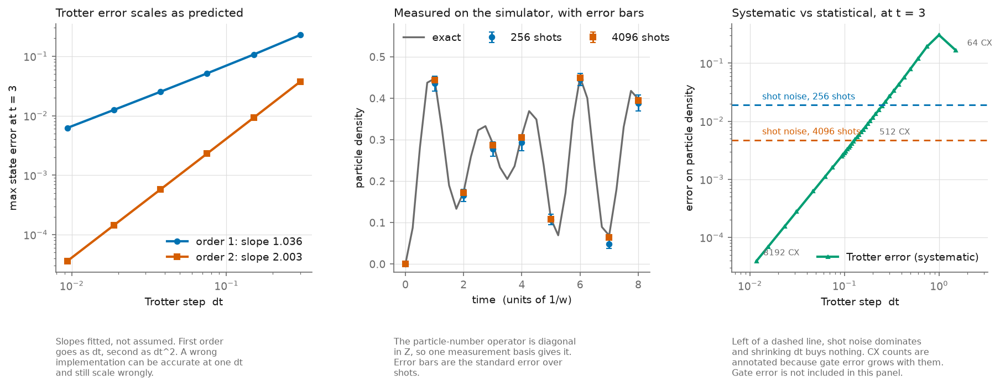

[← Previous](03-why-pairs-appear.md) · [Tour](README.md) · *4 of 9* · [Next: imperfect gates →](05-gate-errors.md)

# 4. Running it as a circuit: time steps and shots

Chapter 3 computed the answer exactly, with a matrix exponential. A quantum
computer cannot do that. This chapter builds what it does instead, and meets
the first two kinds of error. Neither needs faulty hardware: both would be
there on a perfect machine.

## Error 1: chopping time into steps

A gate acts on one or two qubits. The evolution $e^{-i\hat H t}$ acts on all
four at once, so it has to be assembled from pieces. Split the Hamiltonian
into groups whose terms commute with each other:

- the *diagonal* group: the mass and field terms, built only from $\hat Z$;
- *hopping on the outer bonds*, sites 1-2 and 3-4;
- *hopping on the middle bond*, sites 2-3.

Two hopping bonds that share a site do not commute, which is why they sit in
different groups. Each group on its own can be exponentiated exactly. The
whole cannot, because for non-commuting pieces

```math
e^{-i(\hat A + \hat B)\,\delta t} \neq e^{-i\hat A\,\delta t}\,e^{-i\hat B\,\delta t}.
```

The fix is to take many short steps of length $\delta t$, where the mismatch
is small. The leftover is *Trotter error*. Arranging each step
symmetrically, so it reads the same forwards and backwards, cancels the
leading part of it and leaves an error that shrinks as $\delta t^2$. One such
second-order step, the unit every circuit here repeats:



Each piece is a rotation about a Pauli string, and the compiler rewrites it in
the gates a superconducting processor runs natively: single-qubit rotations
(RZ, SX, X) and the two-qubit controlled-NOT, *CX*. One step costs 32 CX,
24 SX and 53 RZ. The CX count matters most, because two-qubit gates are where
hardware makes most of its mistakes. (The simulated processor lets every pair
of qubits interact directly, as trapped ions can. A chip with
nearest-neighbour wiring would need extra swap gates for the field term that
couples sites 1 and 3.)

### Testing the circuit by its slope

A wrong implementation can match the exact answer at one step size by luck.
It cannot also shrink at the right rate. So the test is the *slope*: the
error should fall as $\delta t$ for the simple first-order step and as
$\delta t^2$ for the symmetric one. Fitted, not assumed, the slopes are
*1.036* and *2.003*. With 4000 small steps the circuit reproduces the
exact state to $7\times10^{-8}$.

## Error 2: a finite number of shots

Running the circuit once and measuring all four qubits gives one bitstring,
such as `1001`. That single *shot* says "one pair" or "no pairs" or "two
pairs"; it does not say "0.46 pairs on average". The average comes from
repeating the circuit $M$ times, and its uncertainty falls as $1/\sqrt{M}$:
four times the shots halves the error, the same rule as any repeated
measurement in a teaching lab.

<details>
<summary><b>The standard error, computed exactly</b></summary>

For an observable $x$ that takes the value $x_z$ on bitstring $z$,

```math
\sigma_x = \sqrt{\frac{1}{M}\sum_z p_z\,\bigl(x_z - \langle x\rangle\bigr)^2},
\qquad \langle x\rangle = \sum_z p_z\, x_z .
```

A real experiment has to estimate $p_z$ from its shots. A simulation knows
$p_z$, so $\sigma$ here is computed rather than estimated. Drawing 400
realistic data sets from $p_z$ confirms it: their actual scatter is 0.97 to
1.01 times the quoted $\sigma$.

</details>

At $t = 3$ the shot noise on the particle density is 0.019 with 256 shots,
0.0096 with 1000, and 0.0047 with 4096.

## The crossover

The two errors behave differently. Trotter error is *systematic*: the same
every run, and it shrinks when you take smaller steps. Shot noise is
*statistical*: it scatters from run to run, and it does not care about the
step size at all. Put them on one plot:

<p align="center">
  
</p>

In the right panel the Trotter error (green) falls as the steps shrink, until
it drops under the shot-noise line. **At 1000 shots that happens at a step of
0.18**, between 16 and 17 steps to reach $t = 3$ (0.25 at 256 shots, 0.13 at
4096). To the left of that point a smaller step improves the answer by less
than the statistics can resolve. You cannot see the gain, but you still pay
for it: reaching $t = 3$ takes 320 CX gates at $\delta t = 0.3$ and 6400 at
$\delta t = 0.015$. At the first trough, $t = 1.76$, where the signal lives,
the crossover at 1000 shots is a step of 0.36.

That is the first of the two numbers the project set out to find. On a
perfect machine the advice would be: go down to the crossover and stop. On a
real machine, where every extra CX is another chance to fail, the trade-off
gets sharper. That is the next chapter.

> [!TIP]
> *Check it yourself.* `python scripts/05_qiskit_trotter.py` fits the two
> slopes, measures the density with shots, and prints the crossover for each
> shot count along with the gate cost of each circuit.

*In the code:* [`circuits.py`](../../src/schwinger/circuits.py) (state
preparation, Trotter steps, compilation, shots); the qubit-order convention
that makes Qiskit agree with the physics lives in one tested function,
explained in [`CONVENTIONS.md`](../../CONVENTIONS.md) section 5. Tested in
[`tests/test_circuits.py`](../../tests/test_circuits.py).
*In the thesis:* Sections 3.3 and 3.4 (Methods) and 4.2 (Results).

[← Previous](03-why-pairs-appear.md) · [Tour](README.md) · [Next: imperfect gates →](05-gate-errors.md)
