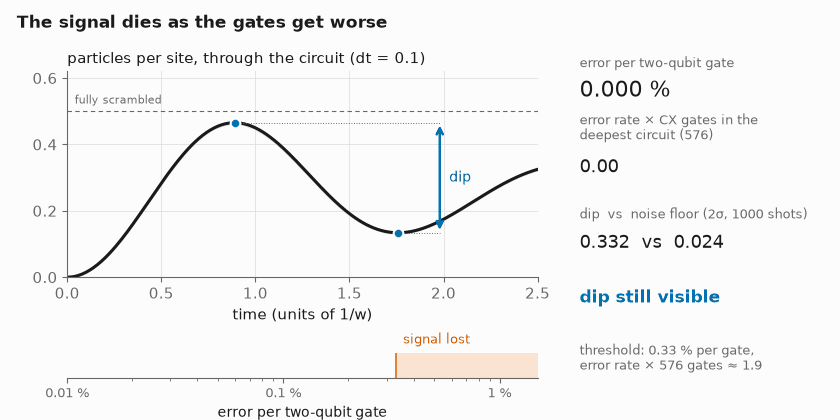
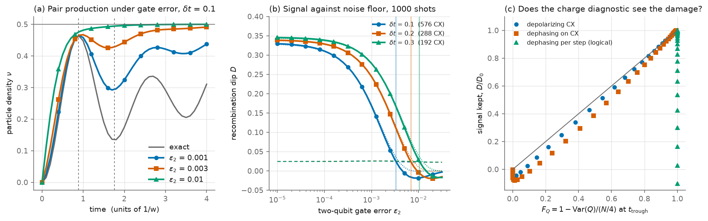
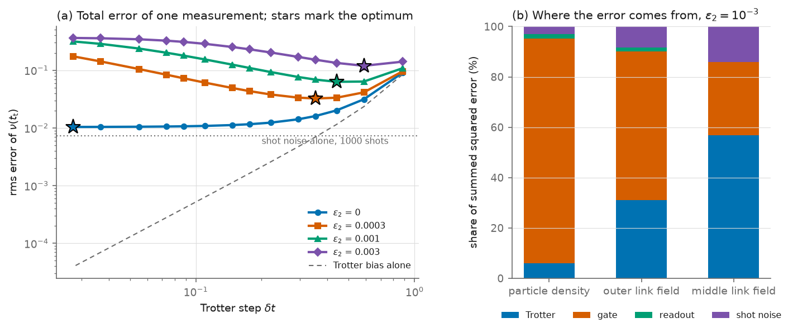

[← Previous](04-time-steps-and-shots.md) · [Tour](README.md) · *5 of 9* · [Next: can the machine tell it is failing? →](06-warning-light.md)

# 5. Imperfect gates, and where the signal dies

Now the hardware gets things wrong. This chapter adds gate errors, finds how
many the pair-production signal can survive, and then puts all the errors
together to find the best step size for a given machine.

## Error 3: the hardware

Each compiled gate gets a *depolarising* error: with some probability the
qubits it acts on are replaced by a completely random state, one in which
every outcome is equally likely. Single-qubit gates are assumed to have a
tenth of the error rate of the two-qubit CX gates; how much that assumption
matters is tested below.

After noise the processor is no longer in one definite state. It is in one of
several, with some probabilities. The tool for that is the *density matrix*,
here a 16-by-16 matrix whose diagonal holds the probability of each of the 16
outcomes. The simulation carries the full density matrix through every noisy
gate, so every probability is exact; nothing is sampled until shots are drawn
on purpose.

<details>
<summary><b>The factor of 4/3 that is easy to get wrong</b></summary>

Hardware papers quote the *average gate infidelity* $\epsilon$ (measured by
randomised benchmarking), not the probability $\lambda$ that appears in the
depolarising channel. For a gate on $d$ dimensions they are related by

```math
\epsilon = \lambda\,\frac{d-1}{d}, \qquad \text{so for a CX } (d = 4):\ \lambda = \tfrac43\,\epsilon .
```

Confuse the two and every threshold below is off by a factor of 4/3. The code
checks its conversion against Qiskit's own fidelity function (agreement
$4\times10^{-12}$). Every error rate on this page is $\epsilon$, the number a
hardware paper would print.

</details>

## Watching the signal die

Noise drags the particle density toward 0.5, its value when every bitstring
is equally likely. Later times go first, because their circuits are deeper.
Here the two-qubit error climbs from zero to 1.5 %, at a step of
$\delta t = 0.1$:

<p align="center">
  
</p>

The signal is the dip from [chapter 3](03-why-pairs-appear.md). Call it
*lost* when it is no bigger than twice its own shot-noise uncertainty at
1000 shots, $D \le 2\sigma_D$. (That criterion is a choice, and the thesis
says so.) The error rate where that first happens is the *failure
threshold*, $\epsilon^\ast$.

## The rule: error rate times two-qubit gates is about two

Smaller steps mean deeper circuits, so the threshold depends on the step. The
deepest circuit is the one that reaches the trough:

| step $\delta t$ | CX gates to the trough | threshold $\epsilon^\ast$ | $\epsilon^\ast \times$ CX gates |
|---|---|---|---|
| 0.1 | 576 | 0.33 % | *1.92* |
| 0.2 | 288 | 0.69 % | *1.98* |
| 0.3 | 192 | 1.06 % | *2.03* |

<p align="center">
  
</p>

Three circuits whose depths differ by a factor of three all lose the signal
at the same point: when the error rate times the number of CX gates reaches
about two. Each of the four qubits takes part in half of the CX gates on
average, so the same rule reads *the summed error of the gates touching the
average qubit reaches about one*. That per-qubit form is the one to carry to
larger machines.

Two things the numbers also show:

- *More shots buy little.* Going from 1000 to 10,000 shots raises the
  threshold by only about 20 %. The dip itself shrinks to zero at an error
  rate just 1.37 times the 1000-shot threshold, and no number of shots can
  resolve a dip that is not there.
- *The single-qubit assumption hardly matters.* Setting the single-qubit
  error to zero, or to three tenths of the two-qubit error instead of one
  tenth, moves the threshold by +8 % and −13 %.

### How this compares with real machines

The one two-qubit fidelity quoted among the papers this project follows is
99.6(2) %, for the trapped-ion processor of
[Rosanowski et al. (2025)](https://arxiv.org/abs/2510.26951): an error of
0.2 % to 0.6 %. That straddles the threshold at $\delta t = 0.1$ and sits
below it at 0.2 and 0.3.

[Farrell et al. (2024)](https://doi.org/10.1103/PhysRevD.109.114510) ran hadron
wave packets on 112 superconducting qubits with up to 13,858 CX gates, about
247 on the average qubit, close to the 288 of the deepest circuit here. With
181 per qubit their raw data showed no wave packet until heavy error
mitigation restored it. Neither Farrell paper quotes its device's gate error,
and Martinez et al. give no gate fidelity, so the rule cannot yet be tested
against published pair-production data.

[Shaw et al. (2020)](https://doi.org/10.22331/q-2020-08-10-306) derived a
worst-case bound for the same model. For depolarising gates it stops saying
anything useful at $\epsilon \times n_{\mathrm{CX}} = 0.4$, a fifth of the way
to where the dip is actually lost here: the kind of small-scale comparison
their paper calls for.

## Putting every error together: the best step size

Now all four sources at once, for one 1000-shot measurement of the density at
the trough, with 1 % readout error (each measured bit misread with
probability 0.01):

<p align="center">
  
</p>

Without gate error (blue), the total error falls as the step shrinks, down to
the floor set by shot noise and readout. With gate error each curve has a
*minimum*, and the minimum moves:

| two-qubit error | best step | CX gates |
|---|---|---|
| 0.03 % | 0.35 | 160 |
| 0.1 % | 0.44 | 128 |
| 0.3 % | 0.59 | 96 |

**The worse the hardware, the coarser the best step.** Refining past the
optimum makes the answer worse, and the figure shows by how much. This agrees
with what [Knee and Munro (2015)](https://doi.org/10.1103/PhysRevA.91.052327)
and Shaw et al. predicted, and with what the experiments of
[Klco et al. (2018)](https://doi.org/10.1103/PhysRevA.98.032331) and
[Nguyen et al. (2022)](https://doi.org/10.1103/PRXQuantum.3.020324) chose by
eye when they lengthened their steps.

### Which error dominates depends on what you measure

At 0.1 % error and the best step, gate error is 89 % of the squared error on
the particle density, but only 29 % on the field of the middle link, where
Trotter error dominates. The reason is simple: the middle link's exact value
at that moment, −0.05, is already close to its value in a fully scrambled
state, zero. Noise has little to erase there. The outer links sit at −0.16,
far from their scrambled value of −0.5, and feel the noise much more. An
observable that noise cannot damage is also one that carries little signal.

<details>
<summary><b>How the budget is split</b></summary>

Four outcome distributions are computed without sampling, each adding one
source of error: exact evolution, the noiseless circuit, the circuit with gate
noise, and then readout error. Differences between consecutive ones give the
Trotter, gate and readout biases, which add up to the total by construction.
One measurement's root-mean-square error is
$\sqrt{b^2 + \sigma^2}$: the total bias squared plus the shot-noise variance.
In 600 simulated experiments the mean squared error is 0.999 times that
prediction. Readout error is undone in practice by inverting a 2-by-2
confusion matrix per qubit, so it gets its own line in the budget and is left
out of the threshold.

</details>

> [!TIP]
> *Check it yourself.* `python scripts/06_noise_threshold.py` (about five
> minutes) sweeps 36 error rates at three step sizes and prints every
> threshold. `python scripts/08_error_budget.py` prints the optimum and the
> decomposition. `python scripts/14_readme_animations.py` rebuilds the
> animation and asserts that its threshold matches.

*In the code:* [`noise.py`](../../src/schwinger/noise.py) (noise models,
exact noisy probabilities, readout), [`budget.py`](../../src/schwinger/budget.py)
(the dip, the threshold, the four-way budget); tested in
[`tests/test_noise.py`](../../tests/test_noise.py) and
[`tests/test_budget.py`](../../tests/test_budget.py).
*In the thesis:* Sections 3.5 and 3.7 (Methods), 4.3 and 4.5 (Results), 5.1
and 5.2 (Discussion).
*Deeper:* [`docs/error-budget.md`](../error-budget.md), sections 3, 6 and 7.

[← Previous](04-time-steps-and-shots.md) · [Tour](README.md) · [Next: can the machine tell it is failing? →](06-warning-light.md)
