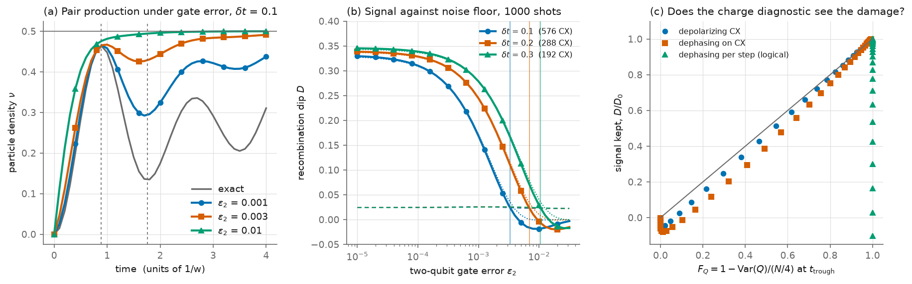

[← Previous](05-gate-errors.md) · [Tour](README.md) · *6 of 9* · [Next: the ground state from bitstrings →](07-ground-state-from-bitstrings.md)

# 6. Can the machine tell you it is failing?

Chapter 5 found the failure threshold by comparing with the exact answer. On
a real quantum computer, running a problem big enough to be worth running,
there is no exact answer to compare with. You need a warning light: something
in the machine's own data that says "this result can no longer be trusted".

## What the physics guarantees, and noise does not

The idea is to watch a quantity that the true dynamics keeps fixed. If the
data show it changing, something other than the physics did it.

Gauss's law looks like the obvious candidate, and in many encodings it is.
Here it cannot be: the field was eliminated by *solving* Gauss's law
([chapter 2](02-four-sites-four-qubits.md)), so it holds on every possible
state of the qubits, noisy or not. There is nothing left to violate. (This
corrected a claim in the original project proposal.) Two exact symmetries do
survive.

*Total charge.* The Hamiltonian conserves the total charge $Q$, and the
simulation starts at $Q = 0$, so every shot should show zero total charge.
Noise does not respect this. The *charge variance* $\mathrm{Var}(Q)$ is
exactly zero without noise and grows as noise pushes probability into
charged bitstrings.

*A mirror symmetry (CP).* Swapping every particle with its antiparticle and
reflecting the chain end to end leaves the dynamics unchanged, as long as the
total charge is zero. For the states this simulation produces, it forces the
two outer links to carry the same field. Their difference, the *CP
asymmetry*, is another check that should read zero.

All of these come from the same measurement that gives the particle density:
one readout of all four qubits in the computational basis. The warning light
costs no extra circuits.

## Turning a violation into a prediction

A light that only turns on is not much use. The goal is a number: from the
symmetry violation measured at one modest noise level, predict where the
signal will be lost.

That needs a model of what noise does. The simplest one, *global
depolarising noise*, says that with probability $1 - F$ the whole state is
replaced by the fully scrambled one, in which all 16 bitstrings are equally
likely. Under it every observable is a weighted average of its ideal value
and its scrambled value, with the same weight $F$ for all of them. In the
scrambled state $\mathrm{Var}(Q) = N/4 = 1$, so the charge variance gives $F$
directly:

```math
F_Q = 1 - \frac{\mathrm{Var}(Q)}{N/4}.
```

The procedure then uses no exact answer anywhere:

1. measure $\mathrm{Var}(Q)$ at the peak and the trough, at one noise level;
2. read off $F_Q$ and undo the global noise to estimate the ideal outcome
   probabilities;
3. assume $F$ falls exponentially with the error rate, as it would if each
   gate independently either works or scrambles;
4. degrade the estimate step by step and find where the dip meets twice its
   shot noise.

## How well it works

*For depolarising gate noise, well, with a known lean.* Using the charge
variance from the exact (unsampled) noisy distribution, taken at a tenth or a
third of the true threshold, the predicted threshold is *10 to 17 % too
high* for all three step sizes. It is always too high. Real gate noise
erodes the dip a little faster than global noise with the same charge
violation would, which is visible in panel (c) below: the blue points sit
just under the diagonal.

<p align="center">
  
</p>

*One real run cannot measure its own lean.* With 1000 shots, the charge
variance carries shot noise of its own. Over 200 simulated data sets the
median prediction is 9 to 18 % too high, and the middle two-thirds of
predictions spread by ±11 to ±16 %, about as much as the lean itself. A
single run comes out optimistic 80 to 92 % of the time.

*For dephasing on the CX gates, worse.* Dephasing scrambles the relative
phase of $|0\rangle$ and $|1\rangle$ without flipping bits. On the gates it
still moves charge, because inside a compiled two-qubit rotation a phase error
on a CX turns into a bit-flip error on the logical state. The same procedure
then overshoots the threshold by *27 to 42 %*. How well the warning light
works depends on the kind of noise, not only on how much of it there is.

## The blind spot

Now put the dephasing between time steps instead, acting on the logical
qubits directly. A phase error there commutes with the total charge, and when
it is the same on every site it respects the mirror symmetry too. The charge
variance stays below $10^{-33}$ and the CP asymmetry at zero, while the dip
shrinks to nothing at a phase-flip probability of 0.036 per qubit per step.

The warning light reads "all fine" the whole way down. In panel (c) these
points form a vertical line at $F_Q = 1$.

This is not an exotic case. It is the noise model Martinez et al. fitted to
their own 2016 data: a phase flip on each qubit with probability 0.038 per
time step ([Martinez et al. 2016](https://doi.org/10.1038/nature18318); their
steps were longer than here, so the two numbers are not directly comparable).
They had already thrown away the shots with the wrong total charge (14 % after
one step, 31 % after four) and modelled what was left. Their charge check and
their dephasing model describe two complementary parts of the noise, and a
charge-based warning light would read exactly zero for the second.

## What a symmetry check can and cannot tell you

A symmetry check bounds the damage from errors that break the symmetry and
says nothing about errors that respect it. That is a general fact
([Cai et al. 2023](https://doi.org/10.1103/RevModPhys.95.045005)); here it is
made quantitative. And since every prediction from unsampled data overshot
the true threshold, a threshold read from a charge check is best treated as
an upper bound on how deep a circuit can go.

> [!TIP]
> *Check it yourself.* `python scripts/06_noise_threshold.py` prints the
> predicted-to-true ratios for every step size (sections C, E and G) and the
> blind-spot run (section D).

*In the code:* [`diagnostics.py`](../../src/schwinger/diagnostics.py)
(charge variance, leakage, CP asymmetry and their standard errors, all from
one set of outcome probabilities), `predicted_dip` in
[`budget.py`](../../src/schwinger/budget.py); tested in
[`tests/test_diagnostics.py`](../../tests/test_diagnostics.py).
*In the thesis:* Sections 2.6 and 3.6, 4.4 (Results) and 5.3 (Discussion).
*Deeper:* [`docs/error-budget.md`](../error-budget.md), sections 4, 5 and 8.

[← Previous](05-gate-errors.md) · [Tour](README.md) · [Next: the ground state from bitstrings →](07-ground-state-from-bitstrings.md)
