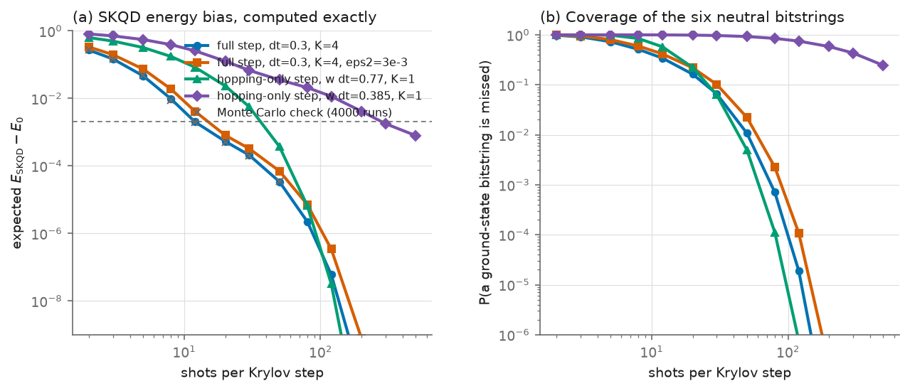

[← Previous](06-warning-light.md) · [Tour](README.md) · *7 of 9* · [Next: how we know it is right →](08-how-we-know-it-is-right.md)

# 7. The ground state from sampled bitstrings

Everything so far was about motion. Some questions are about the state that
does not move: the *ground state*, the lowest-energy state of the
Hamiltonian. One example is the chiral condensate, the ground-state average
(per site) of the operator the mass multiplies; on this lattice it is the
particle density shifted by a constant. This chapter gets the ground state
from the same circuits the dynamics already uses.

## Two ways to find a ground state on a quantum computer

The *variational quantum eigensolver* (VQE) builds a circuit with tunable
rotation angles and lets a classical optimiser adjust them to minimise the
measured energy. It needs many rounds between the two machines, and noise
can flatten the energy as a function of the angles until the optimiser has
no gradient to follow ([Wang et al. 2021](https://doi.org/10.1038/s41467-021-27045-6)).

*Sample-based Krylov quantum diagonalisation* (SKQD,
[Yu et al. 2025](https://arxiv.org/abs/2501.09702)) asks much less of the
quantum computer:

1. start from a simple state, here empty space, and apply one time step $k$
   times, for $k = 1, \dots, K$;
2. measure each circuit and keep only *which* bitstrings appear, discarding
   any with the wrong total charge;
3. on a classical computer, diagonalise the Hamiltonian restricted to the
   bitstrings that appeared.

Step 3 is an exact diagonalisation inside a smaller space, so the energy it
returns can never fall below the true ground-state energy, however noisy the
samples were. The quantum computer's only job is to find the bitstrings that
matter. This project chose SKQD over VQE on 1 October 2026, after reading
[Rosanowski et al. (2025)](https://arxiv.org/abs/2510.26951), who applied it to
this model: it reuses the Trotter circuits already built, needs no optimiser
loop, and tolerates noise by design.
[`docs/LEARNING.md`](../LEARNING.md) topic 9 records the reasoning.

## What the ground state looks like

At these parameters the ground state is mostly empty space:

| bitstring | what it is | weight |
|---|---|---|
| `0101` | empty space | 70.8 % |
| `1001` | one pair, left | 10.0 % |
| `0110` | one pair, right | 10.0 % |
| `0011` | one pair, middle | 7.5 % |
| `1010` | two pairs | 1.7 % |
| `1100` | one pair, stretched across the chain | 0.07 % |

The stretched pair, with field on all three links, is almost absent:
confinement makes it expensive. That is the bitstring a small number of shots
is most likely to miss, and also the one that matters least.

## The only error left, computed exactly

At four sites SKQD has one way to go wrong: an important bitstring that never
turns up in the shots. Its effect can be computed exactly instead of
estimated. The probability that every sampled bitstring lies inside a given
set is a product over circuits and shots, and inclusion-exclusion turns that
into the probability of sampling exactly each of the 64 possible subsets. The
expected energy error is the weighted average over those subsets. Checked
against 20,000 simulated runs: $1.020\times10^{-3}$ from the formula,
$1.002(40)\times10^{-3}$ from the runs.

  

With four full time steps of 0.3:

- the relative energy error falls below $10^{-3}$ at *12 shots per circuit*,
  and by 500 shots it is zero to machine precision;
- the condensate follows, with an expected error of $-8.3\times10^{-3}$ at 5
  shots and $-2.2\times10^{-5}$ at 50;
- with gate error at 0.3 % it needs *15 shots* instead of 12.

Noise makes SKQD slightly worse, not better. It spreads probability over all
16 bitstrings, and the 10 charged ones are thrown away, so fewer of a fixed
number of shots land where they are useful. The single hopping-only step that
Rosanowski et al. use needs 38 shots at the step size they quote and 278 at
the step they effectively applied, because their convention turns each bond
half as far.

## Where it will get hard

The number of zero-charge bitstrings grows fast: 6 at four sites, 924 at
twelve. Rare but important bitstrings that never get sampled will be what
limits SKQD on larger lattices.

> [!TIP]
> *Check it yourself.* `python scripts/07_skqd_ground_state.py` prints the
> ground-state weights, the exact expected error against shots for all four
> configurations, and the Monte Carlo check.

*In the code:* [`skqd.py`](../../src/schwinger/skqd.py); tested in
[`tests/test_skqd.py`](../../tests/test_skqd.py).
*In the thesis:* Sections 1.4, 3.8, 4.6 and 5.4.
*Deeper:* [`docs/error-budget.md`](../error-budget.md), section 9.

[← Previous](06-warning-light.md) · [Tour](README.md) · [Next: how we know it is right →](08-how-we-know-it-is-right.md)
