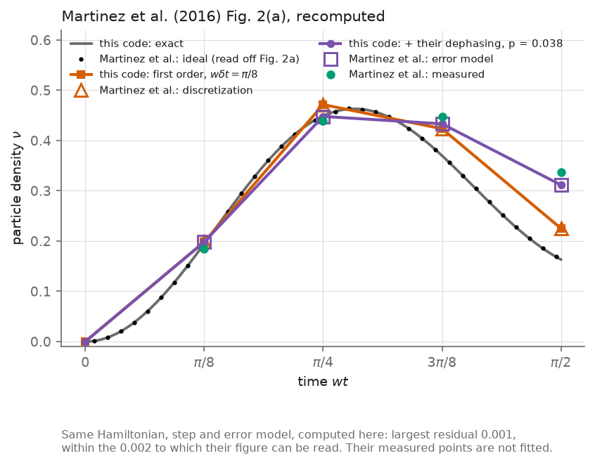

[← Previous](07-ground-state-from-bitstrings.md) · [Tour](README.md) · *8 of 9* · [Next: where this stops →](09-where-this-stops.md)

# 8. How do we know any of this is right?

A simulation can be wrong in ways that look perfectly reasonable. A flipped
sign swaps particles and antiparticles and still produces a smooth, plausible
curve. So this project runs on one rule: **every stage has a known answer
attached, found by an independent route, and nothing is trusted because it
looks right.** Checks report the size of the disagreement (a residual such as
$9\times10^{-16}$), not "passed", because a number says how close and a flag
does not.

## Checks that fail for different reasons

One check can share a mistake with the thing it checks. The defence is to use
several that would each break for a different reason.

- *Three constructions of the Hamiltonian* share nothing but the Pauli
  matrices and the staggering sign: the list of 14 Pauli strings, squaring
  each field operator directly, and starting from fermion operators and going
  through Jordan-Wigner. They agree to $9\times10^{-16}$. This catches errors
  in the algebra and the signs, but not a wrong starting Hamiltonian shared by
  all three.
- *Two limits with known answers* test the physics itself. With hopping
  off, the ground energy must be $-mN/2$ (residual 0). With mass and field
  off, all 16 levels must be sums of free-particle energies
  $2w\cos[k\pi/(N+1)]$ (residual $9\times10^{-16}$). The first is blind to
  hopping and the second to the field, so together they cover both.
- *Scaling, not just size.* The Trotter error must fall with slope 1 or 2
  (measured 1.036 and 2.003), a test a buggy circuit can pass at one step size
  but not across a range.
- *Statistics checked by simulation.* Quoted standard errors match the
  scatter of 400 simulated data sets to within 3 %, and the error budget's
  prediction matches 600 simulated experiments (ratio 0.999).

Every stage of the pipeline carries one:

| Stage | Known answer it is checked against | Residual |
|---|---|---|
| Hamiltonian | three independent constructions | 0 to $9\times10^{-16}$ |
| Hamiltonian | strong-coupling limit, $E_0 = -mN/2$ | 0 |
| Hamiltonian | free fermions, all 16 levels | $9\times10^{-16}$ |
| Gauss's law | holds as an operator identity | 0 |
| Symmetries | $[\hat H, \hat Q] = 0$; CP inside the neutral sector | 0; 0 |
| Exact evolution | energy drift up to $t = 12$ | $5\times10^{-15}$ |
| Circuits | circuit state vs. exact, 4000 steps | $7\times10^{-8}$ |
| Circuits | Trotter slopes, predicted 1 and 2 | 1.036, 2.003 |
| Noise | density matrix vs. state vector, noise off | $1.5\times10^{-14}$ |
| Noise | infidelity convention vs. Qiskit | $4\times10^{-12}$ |
| Statistics | scatter / quoted standard error | 0.97 to 1.01 |
| Budget | mean squared error / prediction | 0.999 |
| SKQD | full sector vs. exact ground energy | $4\times10^{-16}$ |
| SKQD | exact bias formula vs. 20,000 runs | $1.020$ vs. $1.002(40)\times10^{-3}$ |

The full list, every row printed by a script, is in
[`VERIFICATION.txt`](../../VERIFICATION.txt).

## Reproducing the 2016 experiment's curves

The strongest outside check is someone else's published result. The code
reproduces the three theory curves of Fig. 2(a) of
[Martinez et al. (2016)](https://doi.org/10.1038/nature18318): the exact
evolution, their discrete time steps, and those steps with their fitted noise.

<p align="center">
  
</p>

The match is within 0.001, inside the 0.002 to which the published figure can
be read. It also pins down something the paper does not state: their time
step. A step 10 % longer or shorter than $w\,\delta t = \pi/8$ misses their
curve by about 0.05.

## Mistakes found by checking

Some of these were in AI-drafted code or text (see the
[statement on AI assistance](../../README.md#statement-on-ai-assistance)), and
all were caught by the checks rather than by reading.

- *Qiskit's qubit order.* Qiskit reads Pauli labels the same way as the
  physics, but numbers its qubits in reverse. The natural guess, reversing the
  label, is wrong. Found by comparing two constructions numerically.
- *An ill-conditioned textbook step.* The standard recipe for the
  warm-up Ising chain squares a matrix's condition number. Replacing it with
  a singular value decomposition improved the worst residual from
  $7\times10^{-10}$ to $10^{-14}$.
- *A trap in periodic boundaries.* For the periodic Ising chain, two momenta
  need the signed energy, not the square root. Wrong by exactly $|2(h-J)|$,
  and only for $h < J$.
- *No Gauss's-law check in this encoding.* The project proposal planned to
  measure Gauss's-law violation. In this encoding it cannot be violated, so
  the diagnostic became the charge variance ([chapter 6](06-warning-light.md)).
- *Phase noise on the gates is not invisible.* An AI-drafted claim said
  dephasing on the compiled gates would leave the charge variance at zero.
  Simulation showed it does not (variance 0.88): a phase error inside a
  compiled two-qubit rotation acts as a bit flip. Only dephasing between steps
  is invisible.
- *A step written backwards.* Reproducing the 2016 curves showed the thesis
  Methods writing the first-order step in reverse order.
- *Claims about papers.* Checking every literature statement against the
  paper corrected an equation number in Martinez et al. and four claims in the
  thesis draft, including the number of qubits on which Rosanowski et al.
  report energies (20, not 30).

## Break it yourself

The tests are only worth something if they catch real mistakes. Plant one and
see. Each of these is a one-line change, and each was tried in a scratch copy
of the code:

| Plant this mistake | Where | Tests that fail |
|---|---|---|
| Use the hardware infidelity as the depolarising probability (drop the 4/3) | `depolarizing_lambda` in `noise.py`: `lam = infidelity` | 6 of 496 |
| Swap particles and antiparticles | `stagger` in `schwinger.py`: flip both signs | 102 of 496 |
| Forget Qiskit's reversed qubit order | `site_to_qiskit_qubit` in `paulis.py`: `return site` | 22 of 496 |

```bash
.venv/bin/python -m pytest tests/ -q      # 496 passed; then plant a mistake and run it again
```

## Rebuild everything from scratch

```bash
bash scripts/verify_all.sh      # about ten minutes
```

This runs the test suite and every numbered script in order, regenerates every
figure, and rewrites [`VERIFICATION.txt`](../../VERIFICATION.txt) with the
library versions it ran on. Seeds are fixed and versions are pinned in
[`requirements-lock.txt`](../../requirements-lock.txt). A fresh run on
17 November 2026 reproduced the 2 November log line for line, and every figure
came out byte-identical.

*In the code:* [`analytics.py`](../../src/schwinger/analytics.py) (the
known answers), [`replication.py`](../../src/schwinger/replication.py) (the
2016 curves), the [`tests/`](../../tests) folder, and
[`scripts/09_verification_table.py`](../../scripts/09_verification_table.py).
*In the thesis:* Section 3.2 and Table 2; the Statement on AI assistance.
*Deeper:* [`docs/derivation.md`](../derivation.md) section 6 says what each
check does and does not prove.

[← Previous](07-ground-state-from-bitstrings.md) · [Tour](README.md) · [Next: where this stops →](09-where-this-stops.md)
