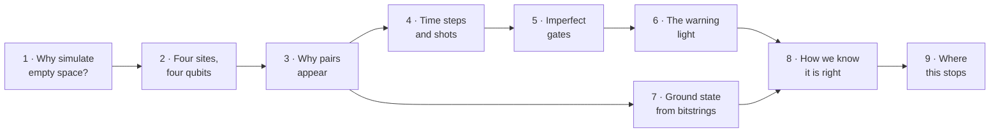

[Front page](../../README.md) · *The tour*

# The tour: the whole project in nine short chapters

Each chapter answers the question the previous one leaves open, and ends with
the code that does the work and a command that reproduces its numbers. Read
straight through in about 45 minutes, or jump to the chapter you care about.

*What you need to start:* one course of quantum mechanics, or the memory of
one. A state is a list of complex amplitudes; probabilities are their squared
magnitudes; the Schrödinger equation moves the state in time. Every other term
is explained where it first appears, and the [glossary](glossary.md) collects
them. The heavier math sits in boxes you can open or skip.

| | Chapter | The question it answers | Minutes |
|---|---|---|---|
| 1 | [Why simulate empty space?](01-why-simulate-empty-space.md) | What is being simulated, why it is hard, and what this project measures | 5 |
| 2 | [From a line of space to four qubits](02-four-sites-four-qubits.md) | How electrons, positrons and their field become 14 terms on four qubits | 7 |
| 3 | [Why pairs appear](03-why-pairs-appear.md) | Why empty space makes pairs, where their energy comes from, and whether four sites are enough | 6 |
| 4 | [Time steps and shots](04-time-steps-and-shots.md) | How the evolution becomes a circuit, and where Trotter error stops mattering | 5 |
| 5 | [Imperfect gates, and where the signal dies](05-gate-errors.md) | How much gate error the signal survives, and the best step size for a given machine | 7 |
| 6 | [Can the machine tell it is failing?](06-warning-light.md) | Whether a symmetry check predicts failure without the exact answer, and where it is blind | 6 |
| 7 | [The ground state from sampled bitstrings](07-ground-state-from-bitstrings.md) | How SKQD gets the lowest-energy state, and how many shots it needs | 4 |
| 8 | [How we know it is right](08-how-we-know-it-is-right.md) | The checks behind every number, the mistakes they caught, and how to break the code yourself | 5 |
| 9 | [Where this stops](09-where-this-stops.md) | The four results in one place, and what they do not cover | 3 |

## Other ways in

- *The thesis,* [`thesis/main.pdf`](../../thesis/main.pdf): the same story
  with every reference, about 8,000 words.
- *The derivation,* [`docs/derivation.md`](../derivation.md): the
  Hamiltonian derived from the continuum Lagrangian, with a twelve-question
  self-test at the end.
- *The error budget explained,* [`docs/error-budget.md`](../error-budget.md):
  noise models, diagnostics, the threshold and SKQD in more detail.
- *The notebook,* [`notebooks/schwinger_walkthrough.ipynb`](../../notebooks/schwinger_walkthrough.ipynb):
  the Hamiltonian, circuits and shots as code, with output already shown.
- *The conventions,* [`CONVENTIONS.md`](../../CONVENTIONS.md): site order,
  signs and Qiskit's qubit numbering. Read this first if a number comes out
  wrong.
